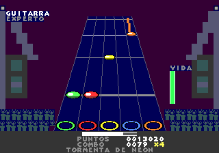
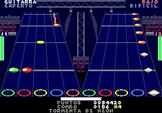

# GENBand

Un juego de ritmo estilo Guitar Hero / Rock Band para la Sega Genesis / Mega Drive. Es el hermano de
[NESBand](https://github.com/Xalcker/NESBand): las mismas reglas y el mismo generador de charts, pero con
el sonido FM del YM2612 y la música importada de archivos VGM.

**Estado actual (v0.2.0):** título con su música, menú (canción, instrumento, dificultad,
fallo), juego para **1 o 2 jugadores** (VS y Co-Op) con pausa, notas sostenidas, frases de poder estelar, medidor de vida, y
pantalla de resultados con precisión, combo máximo y estrellas. Los charts se generan automáticamente para
guitarra, teclado y bajo en 4 dificultades, y si fallas tu instrumento se calla hasta tu siguiente acierto,
como en Rock Band, y la autopista va en perspectiva.

**Canciones:** las diez originales de NESBand (GPL-2.0-or-later), arregladas para FM: *Primer Ensayo*,
*Tormenta de Neón* (rock, guitarra), *Luz de Luna* (balada, teclado), *Salto Mortal* (funk, bajo), *Marcha
del Cartucho*, *Noche sin Estrellas*, *Carrera de Fuego*, *Brisa de Verano* (surf), *Cumbia del Cartucho* y
*Amanecer Digital* (trance).




## Sobre este proyecto

Todo el código de GENBand lo escribió una IA (Claude), igual que el de NESBand.

**Aviso:** GENBand es un proyecto de aficionados, sin relación con Sega, Harmonix ni Activision, ni con
Guitar Hero ni Rock Band. "Genesis" y "Mega Drive" solo indican la plataforma para la que está hecho.

## Instalación (macOS)

```bash
brew install m68k-elf-gcc m68k-elf-binutils uv blastem mame
```

```bash
git clone --depth 1 --branch v2.11 https://github.com/Stephane-D/SGDK.git tools/sgdk
```

- **m68k-elf-gcc**: el compilador para el 68000.
- **SGDK 2.11** en `tools/sgdk/`: la librería para la Genesis (video, controles, DMA). Se usa la librería
  que ya viene compilada (`lib/libmd.a`); no hace falta compilar nada de SGDK ni tener Java.
- **BlastEm**: el emulador para jugar (el más preciso). **MAME**: el de las pruebas automáticas (tiene Lua).
- **uv**: para las herramientas de Python (`uv sync` crea el venv).

`tools/` está en `.gitignore`: cada máquina baja sus propias herramientas.

En **Linux** es lo mismo con los paquetes de la distribución (`gcc-m68k-linux-gnu` no sirve: hace falta
el `m68k-elf`, por ejemplo el de [marsdev](https://github.com/andwn/marsdev)); `PREFIX=` cambia el prefijo
del compilador y `GDK=` la carpeta de SGDK.

## Compilar y jugar

```bash
./build.sh
```

```bash
blastem build/genband.bin
```

El resultado es `build/genband.bin` (y `build/genband.sym`, los símbolos, que usan las pruebas). Compilar
**no** necesita Python más allá del `python3` del sistema (para la suma de verificación de la ROM): las
canciones ya convertidas viven en `src/songs/`.

**Release:** `./build.sh --release` deja `build/release/genband-v<versión>.bin` con su suma de verificación
(`.sha256`) y la licencia. Solo usa lo que está en git (si hay cambios sin commit en `src/` o `audio/`, se niega):
las canciones importadas de juegos comerciales nunca entran. Es reproducible: con las mismas herramientas sale
el mismo archivo. La versión sale del archivo `VERSION` y se ve en la pantalla de título.

La ROM es para consolas **NTSC (60 Hz)**: la música y las notas avanzan un paso por cuadro, así que en una
consola PAL irían más lento.

### Controles

**Menú:** ↑/↓ elige el renglón, ←/→ cambia el valor, Start juega, **A abre las opciones** y B regresa al
título. Mientras eliges, suena la canción.

**Dos jugadores:** en JUGADORES, ←/→ cambia entre `1 JUGADOR`, `2 JUGADORES VS` y `2 JUGADORES COOP`. El
jugador 2 elige su instrumento y su dificultad con el **control 2** (su cursor es rojo; ↑/↓ cambia entre esos
dos renglones). Las dos autopistas van en perspectiva, una en cada mitad de la pantalla, y comparten el scroll:
van a la velocidad de la dificultad más alta de los dos.

- **VS:** cada quien juega su partida. Los dos juegan la misma dificultad (la elige el jugador 1) y, de
  entrada, el mismo instrumento (el 2 copia al 1, pero puede cambiarlo): un duelo sobre las mismas notas. Si
  comparten instrumento, el canal solo se calla cuando los dos están fallando. Al final: `GANA J1 POR 0001230`
  o `EMPATE`; si un jugador pierde (se le acaba la vida) la partida se corta y gana el otro, y esa partida no
  graba récord. Cada quien tiene su récord y escribe sus iniciales con su control.
- **Co-Op (banda):** el **puntaje, el combo y el poder estelar son de la banda**; la **vida es de cada quien**.
  Si uno cae, su instrumento calla y el otro sigue; la banda pierde cuando caen los dos. El que sigue en pie
  puede **revivir al caído con media barra de poder estelar** (A: si hay un compañero caído, revive en vez de
  activar el poder). No pueden tocar el mismo instrumento. El **récord de banda** es aparte (por canción y la
  dificultad más alta de los dos) y solo vale si los dos terminan en pie.

**Opciones (A en el menú):** modificadores para rejugar una canción o aprender una parte difícil, como en
NESBand. Se quedan hasta que las cambies; Start juega y B regresa al menú.

| Opción | Qué hace |
|---|---|
| ESPEJO | Invierte los carriles: la nota verde sale en el carril naranja y al revés (el chart se traduce al leerlo) |
| VELOCIDAD | 100%, 75%, 50% o 125%: la canción, las notas y la música avanzan más lento o más rápido (el juego da 4, 3, 2 o 5 pasos cada 4 cuadros; la música se detiene en los cuadros sin paso, así que suena más lenta con el mismo tono). La autopista se mueve fracciones de paso en todos los cuadros, así que se ve pareja |
| CAIDA DE NOTAS | Qué tan rápido bajan las notas, sin importar la dificultad: AUTO usa la de la dificultad, o la de fácil a experto |
| PRACTICA | La canción se repite hasta 1/4, 1/2, 3/4 o el final, sin fallo y sin resultados. **Marcas:** en la pausa de una práctica, **A** hace que el bucle empiece 2 s antes de donde pausaste y **B** que termine donde pausaste; el bucle debe durar al menos 4 s. **C** regresa al menú |
| INICIO DE LA PRACTICA | Dónde empieza: el principio, 1/4, 1/2 o 3/4 (nunca en o después del final). La música se adelanta hasta ahí; las notas de los primeros segundos se omiten para dar tiempo de reaccionar |
| EFECTO AL FALLAR | SI, SOLO SONIDO o NO |

Con cualquier opción distinta de la normal no se guardan récords (salvo EFECTO AL FALLAR).

**Juego:** funciona con el control de 3 botones y con el de 6.

| Carril   | 3 botones | 6 botones |
|----------|-----------|-----------|
| Verde    | ←         | ← o X     |
| Rojo     | ↓         | ↓ o Y     |
| Amarillo | →         | → o Z     |
| Azul     | B         | B         |
| Naranja  | C         | C         |
| Poder estelar | A    | A         |
| Pausa    | Start     | Start     |

En la pausa, Start sigue y B sale al menú (en una práctica: A y B ponen las marcas y C sale). En BlastEm, por defecto: flechas, A/S/D = A/B/C,
Q/W/E = X/Y/Z, Enter = Start.

**Batería** (4º instrumento): las mismas reglas de NESBand, al estilo de Rock Band. La autopista tiene 4
columnas en su orden (rojo, amarillo, azul, verde) y el **bombo es una barra naranja** que cruza la autopista
y se toca con **C**. Tarola = rojo (↓/Y), tom 1 / hi-hat = amarillo (→/Z), tom 2 / ride = azul (B),
tom 3 / crash = verde (←/X). Los platillos se ven como rombos solo en **experto**; en las demás dificultades se
tocan como toms. Fácil usa bombo, tarola y tom 1; medio agrega el tom 2 y acordes de dos; difícil y experto,
hasta 3 botones a la vez (el pie y dos manos).

Con el control de 6 botones, la mano derecha puede tocar los 5 carriles con X, Y, Z, B y C. Los charts no
piden verde + amarillo a la vez (← y → no se pueden apretar juntos en la cruz), para que sirvan con los dos
controles.

### Reglas

Son las de NESBand:

- Fácil usa 3 carriles, medio 4, difícil y experto los 5. A más dificultad, las notas bajan más rápido
  (6, 5, 4 y 3 cuadros por cada 8 píxeles).
- Tolerancia de ±6 cuadros (~100 ms). Presionar un carril sin nota cerca rompe el combo y calla tu
  instrumento.
- Cada nota vale 50 por el multiplicador (x1, x2 desde 10 de combo, x3 desde 20, x4 desde 30). Cada botón
  de un acorde cuenta como una nota.
- **Notas sostenidas:** acierta la gema y mantén el botón mientras pasa la cola: 10 puntos cada 8 cuadros.
- **Poder estelar:** las gemas en forma de diamante son frases de 4 notas; si las aciertas todas, la barra
  de abajo sube 25%. Con la mitad o más, **A** lo activa: todo vale el doble y la autopista se pone azul.
- **Vida:** el medidor junto a la autopista. Cada acierto sube 1; perder una nota baja 2 (1 en fácil) y un
  golpe al aire 1. Si llega a 0, pierdes (tu instrumento calla y la franja dice FALLASTE). En el menú,
  **SIN FALLO** quita el medidor.
- **Golpe al aire:** suena uno de tres efectos (nunca el mismo dos veces seguidas) y la autopista tiembla
  y se pone roja unos cuadros; en una racha de fallos, a lo más 3 veces por segundo. Una nota que se pasó
  sin tocarla solo calla tu instrumento. Un acorde suma la vida de una sola nota.
- **Estrellas:** salen del puntaje (sin el poder estelar ni las colas) contra el puntaje perfecto: 20, 40,
  60, 80 y 95%.

**Escenario:** alrededor de la autopista hay un escenario de concierto (bocinas, torres con su foco y su haz
de luz) y, abajo a los lados, el **público**. Reacciona a cómo juegas, como en NESBand:

- Sin combo (menos de 10), el público está quieto.
- Con combo, levanta los brazos y **salta al empezar cada tiempo de la canción**, y la luz late con él.
- Con el **poder estelar** activo, las luces cambian de color en cada tiempo (cian, rojo, amarillo y violeta).
- Al completar una **frase estelar** cae un **rayo** sobre el carril de su última nota y las luces destellan.
- Si pierden todos, las luces se apagan.

Con 2 jugadores, el escenario es una torre con dos focos en el centro, entre las dos autopistas. Casi no
cuesta CPU: las luces son dos colores de la paleta y el público son 4 tiles que se redibujan por DMA.

**Récords:** el cartucho guarda el mejor puntaje de cada **canción, instrumento y dificultad**. En el menú,
debajo de FALLO, ves el récord de lo que elegiste (`0029920 ABC *****`: puntaje, iniciales y estrellas, o
`---`). Si lo superas, los resultados dicen **NUEVO RECORD** y con Start escribes tus iniciales como en un
arcade (↑/↓ cambia la letra, ←/→ cambia de letra, Start la guarda). Perder, jugar **sin fallo** o con
opciones (salvo EFECTO AL FALLAR) no graba récord.

Viven en la **SRAM** del cartucho (la RAM con batería): MAME la guarda en su carpeta `nvram`, BlastEm junto
a sus partidas y un flash cart en la tarjeta SD. Cada canción se identifica por un hash de su título y su
juego, no por su lugar en el menú, así que los récords no se mezclan si agregas o quitas canciones. Si el
archivo falta o está dañado (firma y suma de comprobación), el juego arranca con la tabla vacía.

## Importar canciones

La música de Genesis se guarda en **VGM** (`.vgm`, o `.vgz` si está comprimido): son las escrituras a los
registros del YM2612 y del PSG tal como las hizo el juego. Hay colecciones completas en
[vgmrips.net](https://vgmrips.net/). Pon los tuyos en `songs_src/` (está en `.gitignore`: la música de
juegos comerciales tiene copyright y no se sube a git).

Primero mira qué tiene cada canal:

```bash
uv run genband channels "songs_src/Sonic/02 Green Hill Zone.vgz"
```

Muestra cuántas notas y qué altura tiene cada canal (`fm1`…`fm6`, `psg1`…`psg3`, `ruido`) y sugiere cuál
es la guitarra (la melodía), el teclado y el bajo. Después importa:

```bash
uv run genband import-song "songs_src/Sonic/02 Green Hill Zone.vgz" --name ghz --duration 90 --guitarra fm1 --teclado fm2 --bajo fm3
```

| Opción | Para qué |
|---|---|
| `--name` | Carpeta en `src/songs/` (minúsculas) |
| `--title` / `--game` | Lo que se muestra en el menú (si no, sale del VGM) |
| `--duration S` | Segundos que se graban, si el VGM tiene bucle (si no, 120) |
| `--guitarra`, `--teclado`, `--bajo` | Canal(es) de cada instrumento, separados por comas (`fm1,fm4`); sin esto se usa la sugerencia |
| `--bateria` | Canales de la batería (`ruido,fm6`); sin esto, el ruido y los canales que casi no cambian de tono |
| `--beat-frames N` | Cuadros por tiempo, si el tempo detectado sale mal (las líneas de compás no cuadran) |

Deja `src/songs/<nombre>/song.c` (la música, los 12 charts y la ficha de la canción) e `import.json` (las
opciones). `./build.sh` incluye todas las canciones que haya en `src/songs/`, en orden alfabético.
`uv run genband reimport` las vuelve a importar con las mismas opciones (tras mejorar el generador) y
`uv run genband list-songs` las lista.

Qué hace, paso a paso:

1. **Lee el VGM** y repite el bucle hasta la duración pedida.
2. **La música** se convierte a un flujo por cuadro (`vgm.frame_stream`): las escrituras de cada 1/60 s
   juntas, sin las que repiten el valor de un registro. El juego lo toca con su propio reproductor
   (`src/music.c`) en el 68000.
3. **Las notas** de cada canal salen de las escrituras: en el FM, cada *key-on* es una nota y su altura sale
   del bloque y el F-number; un cambio de altura de más de 3/4 de semitono con la tecla presionada es otra
   nota (legato), y uno menor es vibrato. En el PSG, la nota empieza cuando el volumen se enciende (o sube de
   golpe).
4. **El tempo** se estima de los ataques y **los charts** se generan con el mismo generador de NESBand
   (`chart.py`): adornos juntados, notas reducidas por dificultad, carriles que siguen el contorno de la
   melodía, colas, acordes y frases estelares. `check_playable` revisa que nada pida verde + amarillo.

**Silencio al fallar:** el reproductor no corta las notas; pone al mínimo el volumen de los operadores
*portadores* del canal FM (los que suenan según su algoritmo) o la atenuación del PSG, y recuerda lo que
pide la canción. Al acertar se restaura en el acto, así que la nota que estaba sonando se vuelve a oír.

**Batería:** los golpes de sus canales se agrupan (en el ruido, por su tipo; en un canal FM, por su tono) y
cada grupo tiene un papel (bombo, tarola, tom 1-3, y si es platillo) en `src/songs/<nombre>/drums.json`. Si
no existe, `import-song` lo escribe con una sugerencia (el tono FM más grave es el bombo; en el ruido, el
blanco más agudo es el hi-hat y el siguiente la tarola), que se corrige a mano y sobrevive a `reimport`. Con
eso se generan los 4 charts de batería con el generador de NESBand (`drums.py`).

**Lo que aún no suena:** el **DAC** (los samples de batería de muchos juegos). Alimentarlo necesita un driver
en el Z80, que es la siguiente etapa; mientras, esas canciones suenan sin su batería sampleada.

### Editor de charts

```bash
uv run genband edit-chart            # abre en blanco: eliges la canción desde el menú Archivo
uv run genband edit-chart tormenta   # o directo una canción
```

Es el editor de NESBand, con los canales de la Genesis: una página local en el navegador (HTML + Canvas, sin
dependencias; el servidor solo escucha en `127.0.0.1`).

- **Menú Archivo:** *Nueva canción…* importa un VGM (los de `songs_src/` y `audio/`, o escribes otra ruta) igual
  que `import-song`; *Abrir…* lista las canciones de `src/songs/`; *Guardar*, *Exportar song.c* y *Cerrar canción*.
- **Canales de la canción:** las notas de FM 1-6, PSG 1-3 y el ruido sobre la línea de tiempo, con la rejilla de
  tiempos, el cuadro en que arranca la música y el fin. Rueda para el zoom, arrastra para recorrer.
- **Chart:** el de un instrumento y dificultad con sus 5 carriles (←/X, ↓/Y, →/Z, B, C), acordes, colas y frases
  estelares. Las notas con problemas salen en rojo y en la lista de avisos (las mismas reglas que `check_playable`).
- **Editar:** clic en un carril vacío agrega una nota, clic la selecciona y arrastrarla la mueve, `Mayús`+clic la
  quita; teclas `←` `→` carril, `↑` `↓` tiempo, `Supr` borra, `J` acorde con la siguiente, `T` cola, `S` estelar,
  `P` platillo (batería), `Ctrl+Z`/`Ctrl+Y`.
- **Guardar** (`Ctrl+S`) escribe solo la diferencia con el chart automático en `src/songs/<nombre>/edits.json`.
  `import-song` y `reimport` generan el chart automático y luego le aplican las ediciones, así que mejorar el
  generador no las pierde (si una ya no encuentra su nota, se avisa y se omite). **Exportar song.c** guarda y
  vuelve a importar la canción, con lo que su `song.c` sale con los charts editados.
- **Batería:** la tabla de abajo da a cada grupo de golpes su papel (bombo, tarola, toms, platillo) y rehace al
  momento los charts de batería; se guarda en `drums.json`.
- **Escuchar** (`Espacio`) toca la canción desde la línea de golpe, y la línea avanza con la música. La toca
  `genplayer.js`, un emulador del YM2612 y del PSG en JavaScript (sigue al `fm.c` de MAME) que reproduce el mismo
  flujo que va en la ROM; la primera vez tarda un par de segundos en prepararlo. Los botones **M**/**S** de cada
  canal (o las teclas `1`-`9` y `0` para FM 1-6, PSG 1-3 y ruido; con `Mayús`, solo) lo silencian o dejan
  solo. No emula el DAC, el SSG-EG ni el modo especial del canal 3 (las canciones de GENBand no los usan).

`--no-open` no abre el navegador, `--port` cambia el puerto y `--html ruta.html` escribe una página de solo
lectura (sin Escuchar).

## Canciones originales

Se componen en Python con `audio/compose.py`, con la misma notación de NESBand (16 filas por compás,
`nota:filas`, `@Instrumento`, batería con `K.H.S.H.`), pero los instrumentos son **parches FM** (algoritmo,
retroalimentación y los 4 operadores) o envolventes del PSG. El bombo es un seno FM que baja de tono y la
tarola y los platillos van en el ruido del PSG. El resultado es un VGM normal, que se importa como
cualquier otro (y se puede escuchar en cualquier reproductor de VGM):

```bash
uv run python audio/tormenta.py
```

```bash
uv run genband import-song audio/tormenta.vgm --name tormenta --guitarra fm1 --teclado fm2 --bajo fm3
```

Las otras nueve canciones de NESBand no se reescribieron: `audio/nesband_fm.py` convierte sus proyectos de
FamiStudio (copiados en `audio/nesband/`) a VGM. Cada canal del NES va al FM con el mismo papel (pulso 1 →
FM 1 guitarra, pulso 2 → FM 2 teclado, triángulo → FM 3 bajo; ruido y samples DPCM → batería) y cada
instrumento toma un sonido de `audio/sonidos.py` según su nombre, con su volumen traducido a atenuación:

```bash
uv run python audio/nesband_fm.py
```

```bash
uv run genband import-song audio/luna.vgm --name luna --guitarra fm1 --teclado fm2 --bajo fm3
```

*Cumbia del Cartucho* necesita `--beat-frames 36` (el estimador le adivina el doble de tempo).

Los efectos de sonido (mover, aceptar, volver y los tres de fallo) también son los de NESBand
(`audio/nesband/efectos.txt`): `build-audio` los pasa a `src/sfx_data.c` y suenan en el tercer tono del PSG.
Mientras suena uno, lo que la canción le pide a ese canal se guarda y se restaura al terminar.

La música del título es la de NESBand (`audio/nesband/titulo.txt`): `audio/titulo.py` la pasa a FM con
`nesband_fm.py`, en bucle, y `uv run genband build-audio` la convierte a `src/titulo_music.c`.

## Pruebas

```bash
tests/run_tests.sh
```

```bash
uv run pytest
```

`run_tests.sh` compila y juega cada caso en MAME, sin ventana y a toda velocidad, con un bot
(`tests/autoplay.lua`) que pasa el título, elige en el menú con el control como un jugador, toca leyendo
las notas de la RAM y anota los resultados. Comprueba que el juego perfecto acierte todo con 5 estrellas,
que sin tocar se pierda, que SIN FALLO llegue al final, que los golpes al aire rompan el combo, que el espejo y
las velocidades se puedan jugar perfecto, que la práctica se repita y que sus marcas cambien el bucle, que un récord se
guarde con sus iniciales y siga ahí al volver a encender, que la batería se pueda jugar perfecto, que con
2 jugadores VS haya empate con el mismo chart y que gane el otro si uno pierde, que en Co-Op la banda haga
todas las notas y siga si un jugador cae, que el audio suene y que no se pierdan cuadros. El bot toca con los dos controles. El bot llega a las opciones como un jugador (`GENBAND_OPTS`). Cada caso deja en
`build/test-<nombre>/` las capturas, el audio (`audio.wav`) y el registro. `tests/run_tests.sh '*-nada'`
corre solo los casos que coinciden; `--no-build` usa la ROM que ya está.

`pytest` prueba el lector y escritor de VGM, la extracción de notas, el generador de charts y el editor (las
ediciones y guardar y exportar a través de su servidor, sobre una copia de la canción). Si hay `node`, también
toca una canción con `genplayer.js` (`tests/genplayer_run.js` escribe la mezcla en un WAV). Contra el audio de
MAME, la vista previa de *Tormenta de neón* da una correlación de 0.95 en la envolvente (ventanas de 50 ms) y el
mismo volumen (MAME/JS 1.00); la música del título, 0.86.

## Cómo está hecho

- **C con SGDK**, compilado con `build.sh` (no con el makefile de SGDK, que pide herramientas de Windows o
  Java). Los gráficos no son imágenes: `src/gfx.c` dibuja las gemas, los aros, las llamaradas y las colas
  píxel por píxel al arrancar.
- **La autopista en perspectiva** (`src/perspective.c`): la Genesis no escala por hardware, así que el
  fondo (plano B) es un trapecio ya dibujado, con prioridad alta afuera para tapar lo demás; las líneas de
  tiempo (plano A) usan una **interrupción por línea** (`src/hint.s`) que cambia el scroll vertical en cada
  línea de pantalla, como las carreteras de los juegos de carreras; y las gemas (en 7 tamaños) y las colas
  (sprites de 8x16 en 3 anchos) se ponen donde caen. Mientras se juega, nada escribe en el VDP fuera de la
  vblank (todo va por la cola de DMA) para no chocar con la interrupción. La franja de abajo es la ventana
  del VDP.
- **Las notas** se leen del chart poco antes de entrar a la pantalla y viven en una cola de 64; de ahí se
  juzgan y se dibujan. El formato del chart es el de NESBand: pares (cuadros desde la anterior, carriles).
- **La música:** `src/music.c` aplica una vez por cuadro las escrituras del flujo; el Z80 se queda detenido
  con el bus pedido para que el 68000 pueda escribir en el YM2612.
- **El tiempo de CPU:** la interrupción de cada línea se lleva ~40% del 68000, así que el bucle del juego
  tiene que caber en lo que queda: si no cabe, ese cuadro se pierde y la canción (y la música) se atrasa. Por
  eso los sprites se escriben directo en la tabla de SGDK, las cuentas por sprite son de 16 bits (las de 32
  van a libgcc, que es lenta en el 68000), el marcador va a la VRAM en una transferencia por parte y solo si
  cambió, y con 2 jugadores cada marcador se redibuja un cuadro sí y otro no. Las pruebas de MAME revisan
  que no se pierdan cuadros.

## Hoja de ruta

GENBand ya tiene lo que tiene NESBand (1 y 2 jugadores, batería, opciones y práctica, récords, escenario,
release y editor de charts con Escuchar). Lo que falta, más o menos en orden:

1. Driver de sonido en el Z80 para el **DAC** (la batería sampleada de los VGM de otros juegos) y para que la
   música no dependa del 68000.
2. Generar los gráficos al compilar (en Python) en vez de al arrancar: hoy el arranque tarda ~2 s.
3. Mejor arte del escenario (los haces de luz y el público son sencillos) y público también con 2 jugadores.
4. Probar en hardware (flash cart y MiSTer).

## Licencia

GPL-2.0-or-later (ver `LICENSE`).

- **La fuente de las letras** es la de NESBand: *Bongo-8 Mono* de Caffinate (Nathan Scott), de dominio público
  (CC0 1.0). `uv run genband build-font` la convierte de `NESBand/src/font.s` a `src/font_data.c`; los
  caracteres que no trae se quedan con los de SGDK. SGDK tiene su propia licencia (MIT) y no se incluye en el repositorio.
